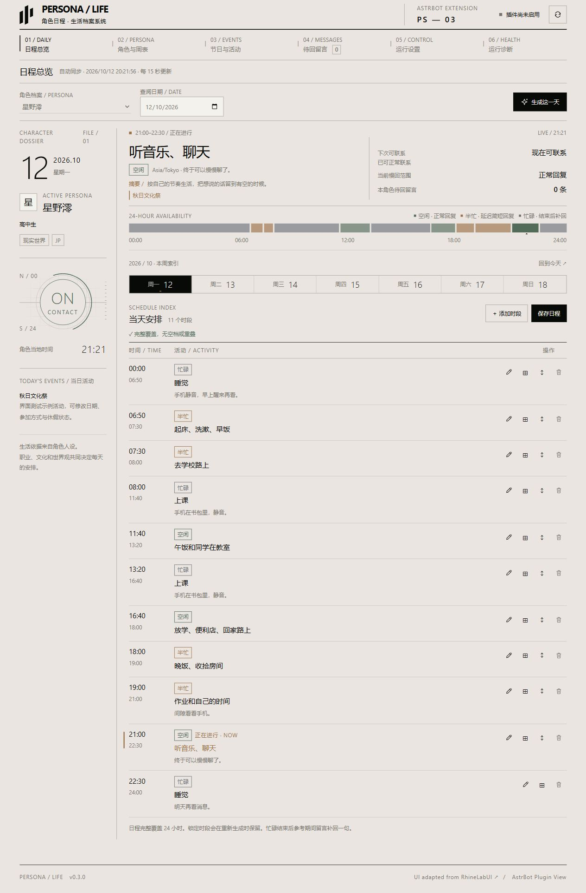
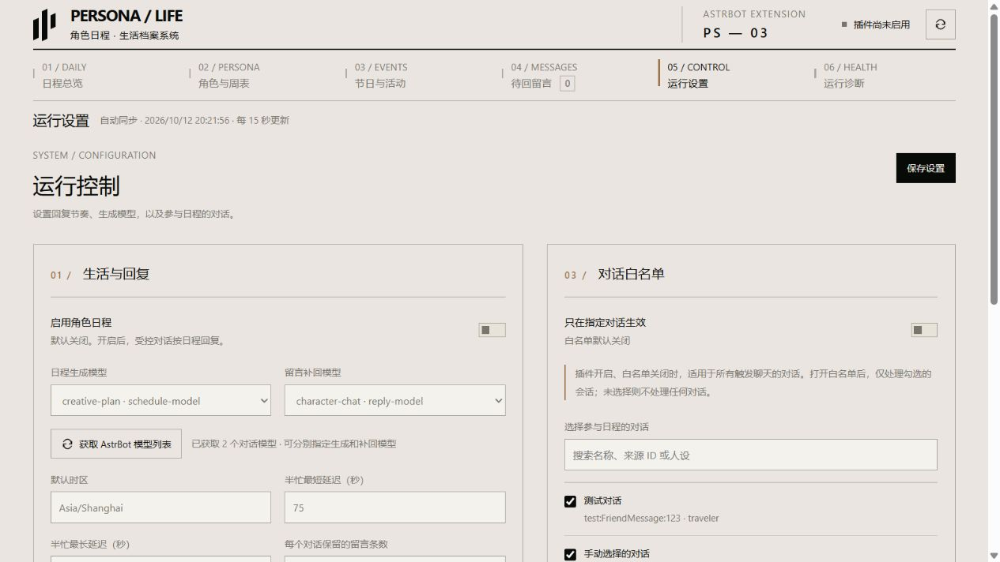
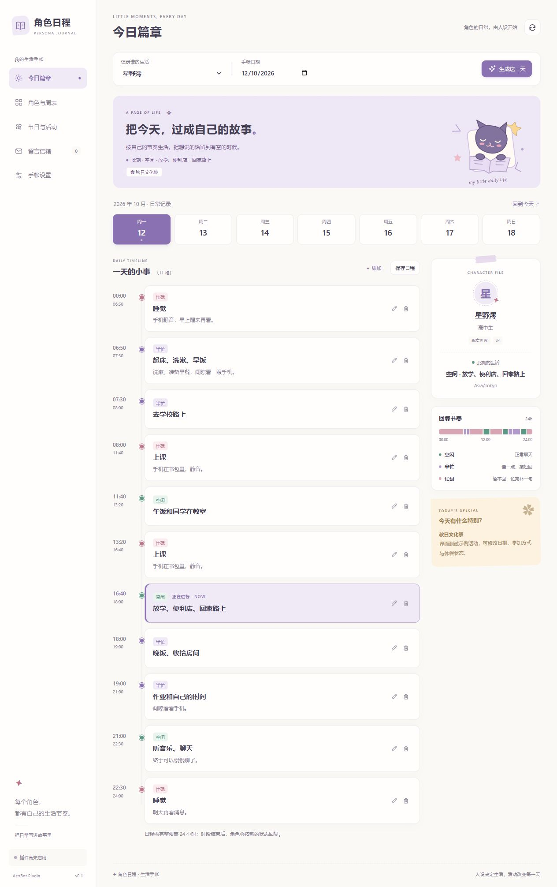
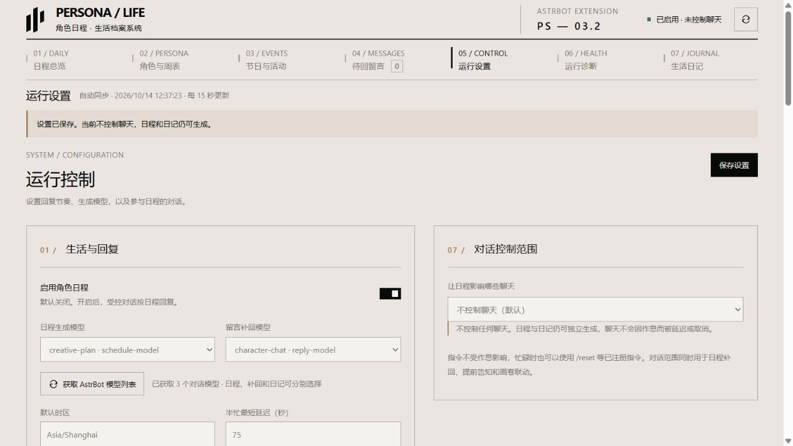
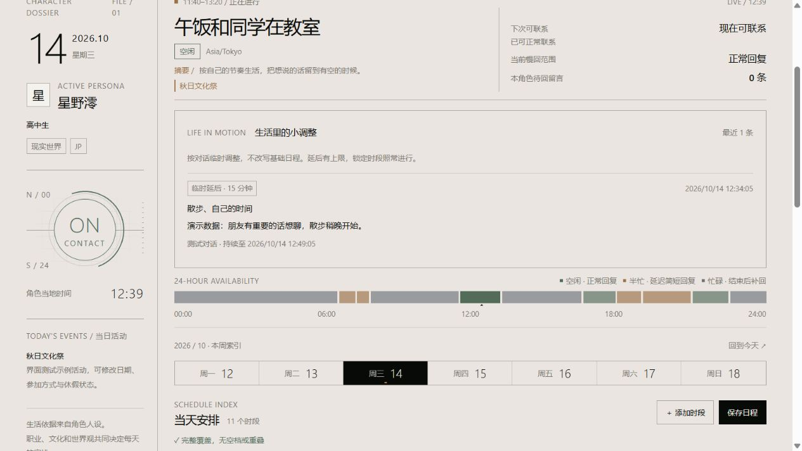

# 角色日程 · AstrBot 插件

让角色按自己的人设过日子：每天安排生活、工作、休息、外出和活动，并让回复速度随之变化。不是学生模板，也不是统一的中国节假日表。

**首次安装插件关闭，对话控制范围默认“不控制聊天”。** 先生成并检查日程，再明确选择白名单或所有聊天；空白名单不会影响任何聊天。

仓库：[iownmmiku/astrbot_plugin_persona_schedule](https://github.com/iownmmiku/astrbot_plugin_persona_schedule)。

版本变化见 [更新日志](CHANGELOG.md)。

## 回复行为

| 状态 | 行为 | 可能的场景 |
| --- | --- | --- |
| 空闲 `free` | 正常走 AstrBot 聊天流程；有积压留言时先合并补回 | 休息、闲聊 |
| 半忙 `slow` | 暂存消息，延迟后合并成一条简短回复 | 外出玩、通勤、吃饭 |
| 忙碌 `busy` | 完全不回复；恢复为可联系状态后，参考期间留言补回一句 | 上课、睡觉、值班、战斗 |

半忙默认延迟 60～180 秒，可调整，也可为周表或当天的具体时段设置独立范围；留空使用全局设置。新留言不会把等待时间一直往后推。实际发送还需加上轮询间隔（默认 15 秒）和模型生成时间。忙碌结束进入半忙时，可以短暂看手机补回；如果接着进入另一个忙碌时段，会继续等待。

没有留言就不会凭空发“我回来了”。普通群消息只在被 AstrBot 唤醒时参与，避免把群里所有闲聊收进去。AstrBot 的 `reset`、`help` 及已注册的插件命令在忙碌时仍可使用；命令不进入留言队列，普通日程监听优先级低于命令。已经被其他插件处理并产生结果的事件也会跳过。

## 人设、世界观与活动

读取 AstrBot 当前实际生效的人设，包括会话覆盖、对话选择及默认人设。相同人设共享一天的生活安排，各对话的待回复消息独立保存。更换人设文本会重新分析，切换对话或人设后不会把旧留言交给新角色。

- **现实世界**：分析职业、生活地区和文化关联，再选择相应公共日历；不根据人设的书写语言猜国籍。中国相关角色可使用农历中秋日期，日本相关角色不会自动套用中国中秋假期。当地相似节庆可以作为不同活动安排。
- **同人世界**：结合角色和原作世界安排活动；可联网找参考资料，缺乏日期依据时明确标为推定。
- **自创世界**：可以创作与当地历史、宗教、物种、季节相关的庆典；不自动套现代学校作息或现实国庆。
- **职业假期与私人活动**：学生的寒暑假、夜班人员的休息日、商人的集市、纪念日、组织活动等都可安排。模型拟定的日期可在界面修改。

活动包括节日、休假、普通活动和纪念日，可跨年。虚构历法需要映射到现实公历日期和运行时区，映射说明会保存在档案中。活动的“休假”指调整常规上课/工作，不等于全天不能回消息；当天时段仍可分别为空闲、半忙或忙碌。

活动来源会显示为公共日历、检索参考、模型创作/推定或手动设置。公共日历由 `holidays` 库提供；它不是所有地区和学校的权威校历，也不能保证未来年度调休已经公布。检索参考不等于经过人工确认的原作正史。

## 安装与使用

1. 需要 **AstrBot 4.28+ / Python 3.12+（已验证 4.28.1）**，并使用支持插件可视化视图的管理面板。建议将 AstrBot 和 Dashboard 都更新到当前匹配版本。
2. 在 AstrBot 插件管理中使用本仓库地址安装，也可上传 `astrbot_plugin_persona_schedule.zip`，或将同名源码目录放到 `AstrBot/data/plugins/`，安装 `requirements.txt` 的依赖后重启/重载插件。
3. 打开 **插件 → 角色日程 → 可视化视图 → 角色日程**。界面通过 AstrBot 官方 `AstrBotPluginPage` bridge（兼容 `AstrBotPluginView`） 和 `register_web_api` 访问后端，沿用 Dashboard 登录；不另开服务端口。
4. 选择已配置的 AstrBot 人设，点击“生成这一天”。首次会依次分析角色生活档案、生成年度活动和当天日程，可能需要几分钟。
5. 检查“角色与周表”“节日与活动”；可以逐项编辑、添加、删除。周表与当天日程需连续完整覆盖 `00:00～24:00`，跨午夜请拆成两段。
6. 在“运行设置”中分别选择日程生成、补回消息及日记模型，设置延迟时间，明确选择对话控制范围，勾选“启用角色日程”并保存。

**独立模型**：界面从 AstrBot 获取当前已加载的聊天模型，显示配置 ID 与实际模型名称，支持手动刷新。日程生成模型负责人设分析、周表、年度活动及当天安排；补回模型只负责慢回/恢复后的合并回复。日记模型可独立指定，留空使用日程生成模型。日程和补回留空跟随当前对话，不修改 AstrBot 原本的聊天模型。这里列出的是 AstrBot 已配置的聊天模型实例；新增模型需先在 AstrBot 模型配置中完成。旧版 `provider_id` 继续作为兼容备用，使用新版视图保存模型选择后会清除此旧项。

**对话控制范围**：默认“不控制聊天”；选择“仅白名单”时，只对勾选的会话生效，白名单为空则不控制任何聊天；只有明确选择“所有聊天”才覆盖全部可唤醒的对话。升级旧版后不再把关闭白名单理解为所有聊天，请重新检查范围。配置中 `whitelist_enabled=true` 优先限制白名单；关闭它时须额外明确设置 `all_chats_enabled=true` 才控制全部聊天。使用 AstrBot 会话来源 ID 匹配，例如 `平台实例:FriendMessage:用户ID`，同一聊天窗口切换历史对话记录仍属于同一会话。界面可搜索并勾选已有对话，也可粘贴 `/日程会话` 返回的 ID。

日程以各角色档案时区运行。打开「主动生成每日程」后，按当地设定时间（默认 00:00）主动补齐当天安排，开机时也会补当天；已有日程不会被覆盖。默认处理所有已分析过的人设，也可指定 AstrBot 人设，首次会自动分析档案。未分析角色在首次生成前使用默认时区触发。此任务按人设共享，不依赖收到聊天，也不会主动发送消息；白名单只控制聊天回复。插件总开关关闭时停止自动生成。首次消息或 `/日程` 仍会即时补齐缺失安排。

## WebUI

v0.3.3 将聊天请求中的动态时间、日程、倦意与活动预告改为临时用户内容块，保持原系统提示词不变，历史保存时由 AstrBot 过滤临时资料。同一请求重复检查只保留最新日程，不影响其他插件内容。

v0.3.2 修复聊天范围与命令优先级，新增弹性联系调整、自然预告和调整记录。界面保留每周时间图、任务进度和运行诊断。部分界面代码与配色改编自 [LBEILC / RhineLabUI](https://github.com/LBEILC/RhineLabUI)，保留 MIT 许可证与作者署名，具体范围见 [第三方说明](THIRD_PARTY_NOTICES.md)。界面支持窄屏布局并跟随 AstrBot 深色主题，使用系统字体与本地图形。

<details>
<summary>查看生活档案界面预览（演示人设与测试数据）</summary>











</details>

- 日程总览：一周日期切换、每日时段索引、此刻状态、下次可联系时间与倒计时；点击时间条可定位具体时段，当前状态按角色时区自动更新。连续忙碌会合并计算；缺少后续日程时显示待生成，避免猜测恢复时间。
- 角色与周表：职业、世界观、文化关联、时区、生活习惯；周表支持七天时间图、单日编辑、拆分时段、锁定和独立慢回范围，边界可拖动或用键盘调整。编辑时即时提示空缺与重叠，保存前仍由后端校验完整覆盖。
- 节日与活动：可翻月的活动日历，点击日期查看那天的日程；年度活动可编辑类型、休假开关、参考链接与来源标记。
- 待回留言：自动更新队列条数、过期与裁剪计数、最早尝试时间、暂停/发送状态、清除和手动重试；后台刷新不会覆盖正在编辑的草稿。
- 生活日记：按人设查看历史、搜索日期/标题/心情、重写已结束日期，翻看归档时的日程依据。
- 运行设置：分别选择日程、补回与日记模型，设置对话控制范围、弹性与提前告知、主动生成时间/人设、随想画卷联动、半忙延迟、队列保留及联网检索。
- 运行诊断：只读检查实际生效的人设、对话、生成与补回模型、后台任务、当前活动和平台发送调用状态；打开诊断不会向用户发送测试消息。

生成任务显示人设分析、活动整理、当天编排、校验保存等阶段。刷新或重新打开视图后，可继续查看正在运行的任务；插件重载/进程重启会将未完成任务标为中断，不会自动重复调用模型，原有效日程仍保留。

修改周表或档案会使旧的活动和日程失效；修改年度活动会使该年已生成的日程失效。锁定的周表时段在重建档案和当天安排时保留，手动锁定的当天时段在重建及活动修改后保留；日期专属锁定优先于周表锁定，锁定也优先于节日调整。日期锁定归档最多保留最近 90 个日期。若要让模型重新安排该时段，请先解锁并保存。重新生成失败时保留上一次有效数据。

## 有弹性的生活节奏

打开「让对话影响日程」后，日程生成模型会在临近/进入忙碌活动时，根据当前消息、本会话近期文字、人设与活动轻重判断：保持安排、有限延后可挪动的个人安排，或给紧急事情一个短暂联系窗口。普通新消息不会自动当成持续聊天或紧急情况。

例如快到睡觉时间时还在聊天，可以再陪聊一会儿，并带上自然倦意。睡眠、休息和可挪动的个人活动默认最多延后 30 分钟（可设 1～120）；上课、会议、值班等固定责任不能随意取消，真正紧急的短答例外最多 5 分钟；锁定时段始终按原安排。截止从原定开始计算，连续片段和跨午夜不会刷新预算，新消息也不会无限续期。

调整属于具体会话和人设，不把其他聊天的事情带过来。基础日程保留，实际可联系状态应用有限覆盖；总览记录调整的活动、时长和原因，日记仅获得不含用户私密原因的调整摘要。更换对话/人设、编辑来源日程或关闭弹性后，旧调整失效。判断失败时保持原安排。额外判断使用日程模型，默认同一活动 180 秒内不重复；从新消息发展为持续聊天可重新判断一次。

「忙碌前自然打招呼」独立开关默认开启。临近活动前默认 10 分钟，在正常回复中自然提起一会儿要做什么；如果没有刚好要回复的消息，也可给最近 10 分钟真正聊过的受控会话发一句告知。不会因为只查看了 `/日程` 就推送，也不会给久未聊天的人发通知。同一预告边界只使用一次告知机会，延后后临近新的截止可再告知一次；实际发送前复核时间、身份、范围和新消息，结果不确定时不自动重发。主动告知依赖平台主动发送能力，生成使用补回模型。

跨午夜仍在持续聊天时，会按需要预先生成次日日程，用来判断紧接着的安排。自动通知只使用已有日程，不为久未聊天的人额外生成下一天。

## 每日生活日记

「跨日后自动写日记」默认开启，需同时开启插件总开关。当地日期结束后的下一次后台检查，会根据已保存的日程和活动，用角色第一人称写日记。日记模型留空时使用日程模型，也可单独选择。不会读取聊天记录、自动发给用户或写入 AstrBot 对话历史。

重启后每次检查为每个人设补一篇最近 7 天内缺失的日记；没有保存日程的日期不凭空补写。归档包含当天日程快照，重建档案、活动和日程不会删除日记；当天与未来日期不能提前写。手动重写成功后替换选定篇目，失败保留原文。人设文本改变后仍可阅读旧篇目，并显示旧人设标记。

默认每个人设保留 180 篇，可设为 7～1095；下一次归档时清理超出的较早篇目。日记是依据角色安排创作的生活回忆，不是现实行动记录。正常聊天的日程缓存和日记归档独立保存。

## 联动随想画卷

同时安装 [随想画卷 0.5.8+](https://github.com/iownmmiku/astrbot_plugin_persona_canvas)，在日程的「运行设置」打开「联动随想画卷主动回复」（默认关闭）。遵守日程总开关和会话白名单：

- 忙碌时取消随想画卷本次主动消息与早安照片，不进入留言补回队列，也不在忙碌结束后补发这次主动内容。
- 空闲或半忙时，主动决策和照片内容参考当天摘要、当前活动与节庆；半忙时提示简短自然。
- 在生成前、角色决策后、图片生成后发送前复核；期间变忙、切换人设/对话或活动改变时，取消旧内容。
- 联动关闭、白名单外或没有安装日程插件时，随想画卷保持原行为。联动已适用但日程不可用时跳过该次主动联系，等待后续机会。查询只读取当天缓存，不为这条主动消息额外生成日程；可开启独立主动生成任务提前安排。

## 官方面板看不到入口

4.28.1 的官方面板扫描 `pages/<名称>/index.html`。本版本已将页面移至 `pages/schedule/`，同步 `pages.schedule` 翻译和元数据。更新后重载插件，并刷新 AstrBot 插件列表，再打开「可视化视图 → 角色日程」。若仍无入口，核对实际安装目录含 `pages/schedule/index.html`，以及 AstrBot 后端与 Dashboard 版本是否匹配。

## 可选联网查找

在“运行设置”打开联网检索并填入 **Tavily API Key**。只在生成年度活动时检索一次世界名、身份和文化关键词，结果和链接会供模型参考；没有配置或服务不可用时，继续按人设生成并注明未检索，不编造搜索来源。搜索需要自己的 Tavily 账户，可能产生该服务的费用。已有密钥不会回显，留空保存会保留它，勾选清除才删除。

## 命令

| 命令 | 用途 |
| --- | --- |
| `/日程` | 查看当前角色当天安排；插件未启用时也可预览 |
| `/日程会话` | 获取当前会话来源 ID |
| `/日程重建` | 管理员重新生成今天的日程 |

## 消息保存与平台能力

队列默认每会话保留最近 60 条留言、最长 72 小时，可配置。每条留言按自己的接收时间过期，同一队列中的新留言继续保留；插件关闭时仍进行过期清理。超出条数时裁掉较早留言，界面显示裁剪与过期数量。队列保留文本、发送者显示名、时间和当时活动；非文本消息只保留提示，不解析图片和语音。

进程重启后恢复队列。平台发送发生异常或上次在发送中退出时，会标为“待核对”，避免自动重复发送；请核对实际平台，再点击重试。成功发送的消息会尽量写回 AstrBot 对话历史，写历史失败不会重复发给用户。诊断中的“调用已通过”只代表 AstrBot 匹配平台并完成发送调用，不代表远端用户已收到或阅读。

补回和慢回依赖平台的 **主动发送能力**。OneBot 等支持会话主动发送的平台适合使用；不支持主动发送的平台、受限的 QQ 官方接口或只允许当前请求流返回的 WebChat 环境，需要先验证平台能力。若平台无法确认送达，队列会保留或暂停，不能保证跨平台送达。

本插件控制当前 AstrBot 消息处理链；其他插件独立定时主动发送的消息，需要那些插件自行协作。生成配置出错或模型不可用时记录错误并暂时放行正常聊天，避免错误设置把机器人永久静音。补回只生成纯文本，不代执行用户在留言中提出的工具操作。

数据保存到 AstrBot 为插件提供的 `data/plugin_data/astrbot_plugin_persona_schedule/`（具体位置由 AstrBot 决定）。状态文件含人设衍生档案、待回复文本和插件设置，请像 AstrBot 配置文件一样保护备份，勿公开上传。

## 开发验证

安装依赖后运行：

```sh
python -m unittest discover -s tests -p "test_*.py"
```

测试覆盖真实国家日历与农历日期、日程校验、三种状态、合并回复、白名单、重启恢复、发送异常、切换对话、生成期间的新留言与配置变动，以及逐条过期、锁定合并、独立模型、任务进度、诊断脱敏、跨日归档、主动生成、命令绕过、弹性窗口、告知防重和联动契约。另提供基于真实 AstrBot SDK 的隔离离线集成脚本，已在官方 4.28.1 源码验证，覆盖页面发现与资源加载、日记归档及主动联系上下文；它使用记录型模型和平台，不连接真实机器人账号，也不能代替外部平台送达验证。具体命令和验证范围见 [集成测试说明](docs/INTEGRATION_TESTING.md)。

`tests/preview_server.py` 仅用于本地界面 QA，使用虚构演示数据和模拟 bridge，监听 `127.0.0.1:8769`；正式插件不启动它。

官方接口参考：[插件可视化视图](https://docs.astrbot.app/dev/star/guides/plugin-pages.html)、[调用 AI 与人设管理](https://docs.astrbot.app/dev/star/guides/ai.html)、[事件与停止传播](https://docs.astrbot.app/dev/star/guides/listen-message-event.html)、[Tavily 搜索 API](https://docs.tavily.com/documentation/api-reference/endpoint/search)。
